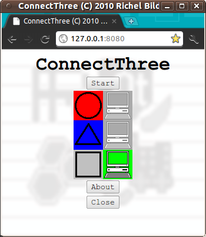
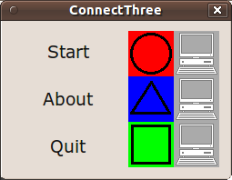
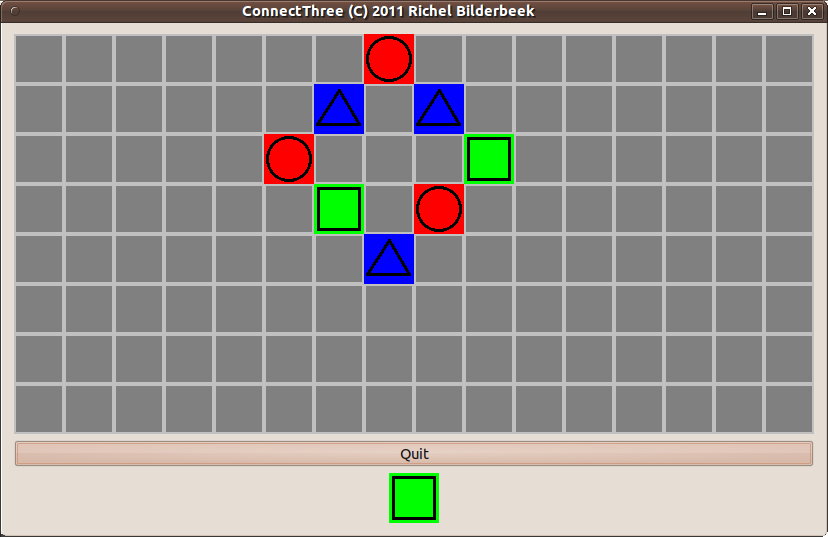
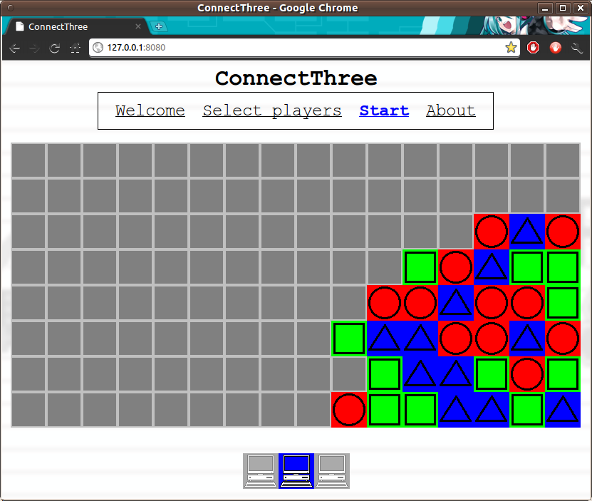

# ConnectThree

<!-- markdownlint-disable MD013 --><!-- Badges cannot be split up over lines, hence will break 80 characters per line -->

<!-- markdownlint-enable MD013 -->

C++ game of 'Connect Three' that uses Qt and Wt.

## External links

* [Richel Bilderbeek's games](https://github.com/richelbilderbeek/Games)
