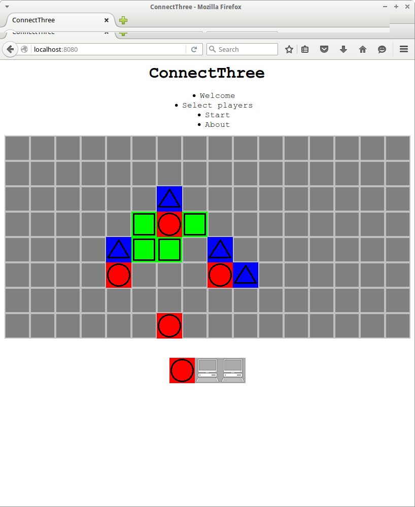
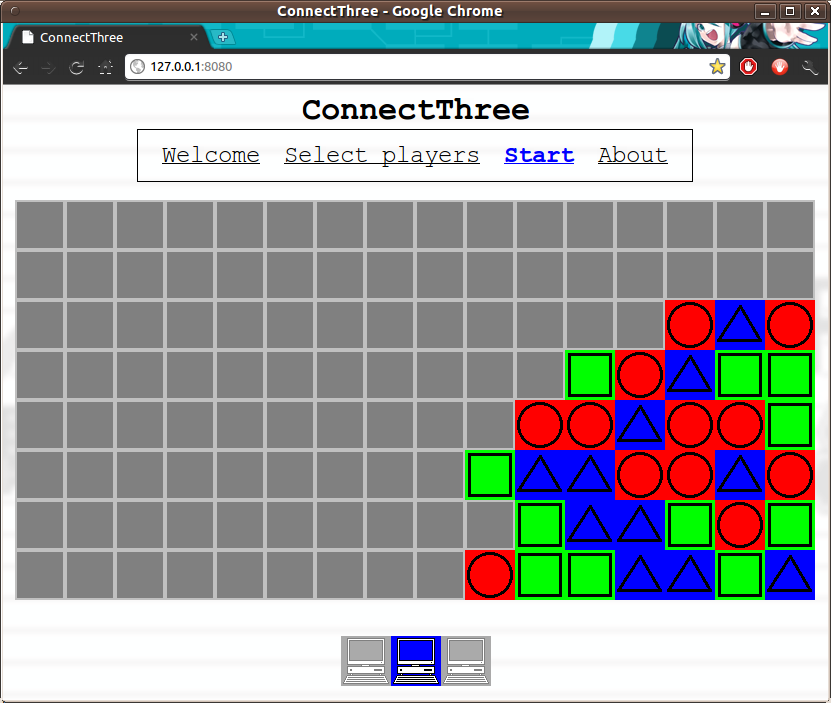
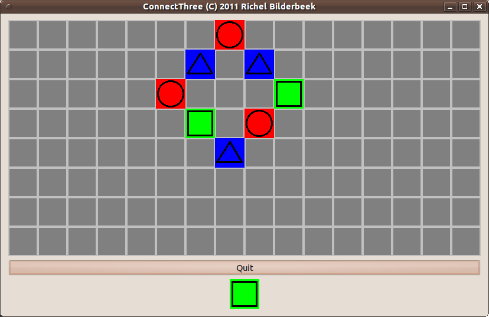

# Connect Three

Connect Three is one of [Richèl Bilderbeek's games](https://richelbilderbeek.github.io/games/).

A C++ game of 'Connect Three' that uses Qt and Wt.

## Screenshots

## Links

- [Source code](https://github.com/richelbilderbeek/ConnectThree)
